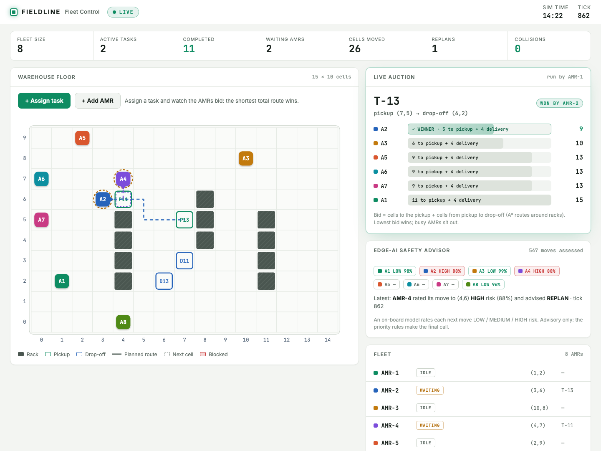

# FIELDLINE: Edge-AI Distributed AMR Fleet Coordination

**Project title:** Edge-AI Based Distributed Fleet Coordination for Autonomous Mobile Robots (AMRs) in Smart Warehouses.

A prototype fleet of autonomous mobile robots (AMRs) that coordinate **peer to peer** in a warehouse simulation. An operator assigns tasks from a live dashboard. Robots **bid** for each task, and the lowest-cost bid wins. Each robot plans its own path with A*, exchanges movement intent with peers, resolves conflicts using priority rules, and queries an **Edge-AI** model for advisory move-risk estimates. Robots can be **added to the running fleet** while the demo is active.

Automated tests run through GitHub Actions on pushes and pull requests. The simulation and model are prototypes; this repository does not claim validation on physical warehouse robots.



## What the demo shows

- **Live task auctions.** Click a pickup cell and a drop-off cell. AMR-1 announces the task, every idle robot computes its own bid (cells to the pickup + cells from pickup to drop-off), and the lowest bid wins. The dashboard shows every bid and the winner.
- **Scalable fleet.** The fleet starts with 3 robots. Press **+ Add AMR** and click a free cell to add another (up to 10). It joins the running fleet and bids like the others.
- **Decentralised movement.** Each robot announces its next cell to its peers, then moves or waits. Same-cell, head-on and swap conflicts are resolved by priority, with rerouting when a path stays blocked.
- **Edge-AI safety advisor.** A RandomForest model rates each next move LOW, MEDIUM or HIGH risk and advises MOVE, WAIT or REPLAN. It is advisory only: the deterministic priority rules make the final decision.
- **Collision checking.** A simulation clock moves every robot at most one cell per tick and checks every tick for two robots in one cell or two robots swapping cells.

## Architecture

```
 Browser dashboard  ──HTTP / WebSocket──  server.py (FastAPI)
                                              │  SimulationManager (simulation.py)
                                              │  · starts one process per robot
                                              │  · runs the tick clock
                                              │  · collects telemetry (observe only)
                         ┌────────────────────┼────────────────────┐
                    AMR-1 process        AMR-2 process        AMR-N process
                  fleet_controller.py  fleet_controller.py  fleet_controller.py
                  (also the auctioneer)
                         └──────── UDP peer-to-peer messages ───────┘
                          STATE · INTENT · TASK · BID · TASK_ASSIGNED
```

- **The robots decide; the server observes.** Movement and bidding happen inside each `fleet_controller.py` process. The server only launches processes, forwards operator commands and displays telemetry.
- **The tick clock** sends INTENT and MOVE phases. Every robot acknowledges each phase, which makes movement reproducible and lets the clock check for collisions.
- **Adding a robot:** the server tells the running robots about the newcomer (ID, port, priority) first, then starts its process. Once it reports in, it joins the clock between two ticks.

## Run it

The project is tested with Python 3.14. On macOS or Linux, run these commands from the repository root:

```bash
python3 --version
python3 -m venv .venv
.venv/bin/python -m pip install --upgrade pip
.venv/bin/python -m pip install -r requirements.txt
.venv/bin/python run_demo.py
```

The dashboard is served at <http://127.0.0.1:8000> once the fleet is live (usually after a few seconds). Press `Ctrl+C` in the terminal to stop the demo. Use the `.venv` Python executable so the app uses the project dependencies.

### Troubleshooting

- If port conflicts occur, stop any previous demo processes before starting again.
- If the dashboard does not load, check the terminal output from `run_demo.py` and confirm that `http://127.0.0.1:8000` is reachable.
- Do not commit `.venv/`, generated logs, local `.env` files, or credentials. These are excluded by `.gitignore`.

## Tests

```bash
.venv/bin/python -m unittest discover -s tests
```

33 tests cover path planning, auctions, tick gating, collision detection, operator tasks, adding robots and the HTTP API. The integration tests start real controller processes and use ports 7001–7004, 7100 and 7200, so stop any running demo first.

## Project layout

| Path | Purpose |
|---|---|
| `run_demo.py` | One-command launcher: starts the server and opens the dashboard |
| `server.py` | FastAPI app: dashboard, `/api/state`, `/api/tasks`, `/api/amrs`, WebSocket updates |
| `simulation.py` | Tick clock and `SimulationManager` (processes, telemetry, tasks, fleet) |
| `fleet_controller.py` | One robot: A*, P2P messaging, bidding, conflict resolution, Edge-AI calls |
| `edge_ai_risk.py`, `edge_ai_integration.py` | Edge-AI risk model and the interface the controllers use |
| `scenario.py` | Warehouse grid, racks, starting fleet, sample tasks, ports |
| `static/index.html` | The dashboard (single file, no build step) |
| `main.py` | Baseline benchmark: centralised A* with path reservations |
| `tests/` | Unit and integration tests |
| `docs/ARCHITECTURE.md` | Architecture overview and component responsibilities |
| `.github/workflows/tests.yml` | Automated test workflow for pushes and pull requests |
| `legacy/` | Earlier prototypes, kept for reference |

## Limitations and roadmap

This is a prototype. We are explicit about what it does not do yet:

| Today | Next step |
|---|---|
| Every robot runs on one machine over localhost UDP | Same messages over a real network; each robot addresses its peers by IP |
| AMR-1 is the only auctioneer, so new tasks stop if it fails | Elect a new auctioneer when AMR-1 stops responding |
| A central tick clock drives movement, for reproducibility | Real robots run on wall-clock time; the clock stays as a test harness |
| The Edge-AI model is trained on synthetic data | Retrain on logged sensor and telemetry data from real runs |
| UDP messages are not authenticated | Sign messages or use DTLS |
| Every robot messages every peer; auctions run one at a time | Multicast messaging and parallel auctions for larger fleets |
| Grid world: no kinematics, battery or real sensors; the blocked-aisle demo uses a fixed cell | Plug in real localisation and obstacle sensors (LiDAR or camera) behind the existing detection hook |
| Zero collisions is verified by tests and per-tick checks, not formally proven | Formal verification of the conflict rules |
| Robots can be added but not removed | Graceful removal and handover of in-progress tasks |
