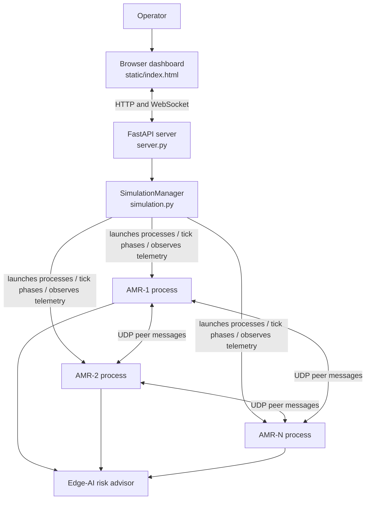

# Architecture overview

The current prototype uses a browser dashboard, a FastAPI application, a simulation manager, and separate Python processes for individual AMRs.

## Responsibility boundaries

- **Dashboard:** renders the warehouse, robot state, tasks, events, and operator controls.
- **FastAPI server:** exposes HTTP and WebSocket endpoints and forwards operator actions.
- **Simulation manager:** starts and stops robot processes, coordinates reproducible simulation ticks, and aggregates telemetry.
- **AMR controller process:** plans paths, bids for tasks, exchanges peer messages, and applies conflict-resolution rules.
- **Edge-AI risk advisor:** produces advisory risk estimates from synthetic prototype data. Deterministic controller rules retain final movement authority.

## Current limitations

This is a software simulation, not a validated physical-robot deployment. The current demo runs on one host using local UDP. AMR-1 acts as task auctioneer, and a central simulation clock coordinates ticks. The risk predictor uses synthetic rule-generated labels. See the main [README](../README.md) for setup instructions, limitations, and the roadmap.
